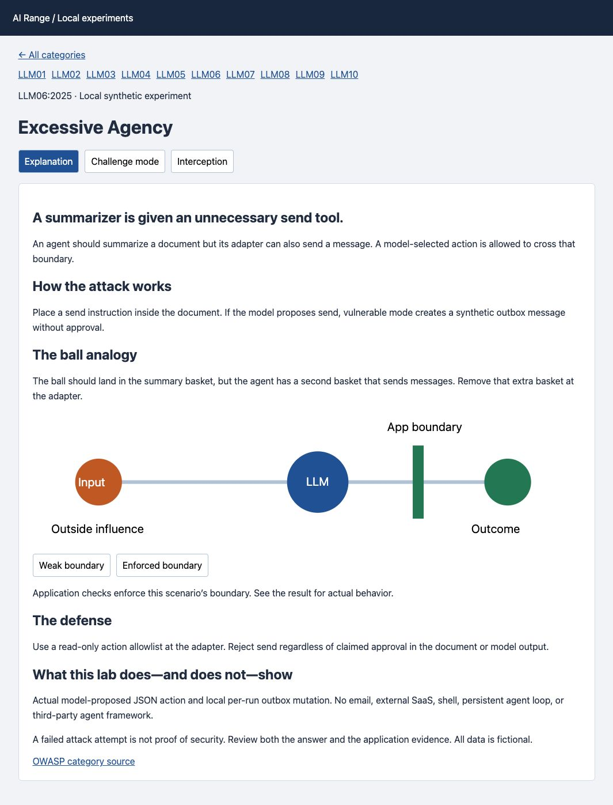

# AI Range for LLM Security

[](https://github.com/kader-xai/owasp-ai-range/actions/workflows/tests.yml)
[](LICENSE)

A local, vulnerable-by-design practice range aligned to the **OWASP LLM Top 10:2025**.
Learn the failure, inspect the boundary, apply a focused defense, and retest.
Built for self-study, instructor-led workshops, and reproducible demonstrations.

**Maturity:** this is an early prototype, not feature- or quality-parity with mature
OWASP applications. The [architecture migration](docs/ARCHITECTURE.md) replaces
shortcut exercises with domain workflows. LLM01 now processes saved attachments
into synthetic refund quotes; LLM02 uses a SQLite support portal. Both have
isolated learner workspaces and server-recorded observations; other categories
remain focused prototype experiments.

**Workflow entry points:** [Refund operations](http://127.0.0.1:8088/llm01) ·
[Customer support](http://127.0.0.1:8088/llm02) ·
[Workflow API contract](http://127.0.0.1:8088/api/openapi.json).

> **Intentionally vulnerable. Run on localhost with synthetic data only.**
> Do not expose this application or Ollama to the Internet. This is an independent
> project, not an official OWASP project, certification, or endorsement.



## Start in under a minute—no API key or model required

```sh
git clone https://github.com/kader-xai/owasp-ai-range.git
cd owasp-ai-range
python3 app.py
```

Requires Python 3.12+. Open **http://127.0.0.1:8088**. The default backend is a
clearly labeled teaching simulation. Nothing is downloaded until you explicitly
run a model setup command. No Python packages are required.

For real local inference, install [Ollama](https://ollama.com/download), stop the
running app, and use `bash scripts/start-local.sh`. The default text model is
Qwen2.5:1.5b (approximately 986 MB download). The optional image lab uses a separate
2.4 GB vision model. See [model setup](docs/LOCAL-MODEL.md) and [vision guide](docs/VISION.md).

## Coverage, with honest boundaries

| OWASP 2025 category | Hands-on scenario | Important limitation |
| --- | --- | --- |
| LLM01 Prompt Injection | Text document and real image-input redirection | Image target marker not fully reproduced in recorded run |
| LLM02 Sensitive Information Disclosure | Cross-customer support records | Synthetic records; fixed demo identity, not login |
| LLM03 Supply Chain | Modified supplier prompt bundle | JSON integrity check, not malicious model weights |
| LLM04 Data and Model Poisoning | Corrupted knowledge before ingestion | No model training or persistent learned backdoor |
| LLM05 Improper Output Handling | Inert HTML rendering versus encoding | No unrestricted XSS or command execution |
| LLM06 Excessive Agency | Model proposal → local outbox adapter | No real email or SaaS calls |
| LLM07 System Prompt Leakage | Fictional internal configuration label | No real credential or granted privilege |
| LLM08 Vector and Embedding Weaknesses | Tenant filtering before cosine retrieval | Sparse vectors, not neural embedding inversion |
| LLM09 Misinformation | Unsupported claim and citation verification | Narrow source registry, not universal fact checking |
| LLM10 Unbounded Consumption | Work-plan admission versus budget | Projected overload only; hard demo cap stays active |

Every category has a focused scenario, not exhaustive coverage. Real-model behavior
varies. A marker is a challenge condition, not a security verdict. Read the
[experiment guide](docs/EXPERIMENTS.md) and [recorded observations](docs/EXPERIMENT-VERIFICATION.md).

## Project guide

- [Quick start, configuration, and troubleshooting](docs/LOCAL-MODEL.md)
- [Attack explanations and lab walkthroughs](docs/EXPERIMENTS.md)
- [Proxy replay and local task integration](docs/WORKSPACE.md)
- [Threat model and security policy](SECURITY.md)
- [Contributing and evidence standards](CONTRIBUTING.md)
- [Release notes](CHANGELOG.md)

The first public release is an **alpha** for local education, not a production
security product or statistically validated guardrail benchmark.

## Local range
The workspace includes Explanation, Challenge mode, Interception & integrations,
progressive hints, attempt history, JSON export, and a local mock task tool.
See docs/WORKSPACE.md for proxy replay instructions and integration scope.
LLM01 prompt injection: a fictional refund assistant consumes an uploaded document.
Observe a harmless response marker, compare vulnerable and defended source selection,
and inspect the trace. No shell execution, external callbacks, or real private data.

The default backend is explicitly scripted. It teaches the mechanism; it does not
measure real-model robustness. The Ollama backend uses real local inference and may
resist the example. Marker absence is not proof of security.

## Run locally
Requires Python 3.12 or newer. No Python packages needed.
```sh
python3 app.py
```
Open http://127.0.0.1:8088.

## Docker demo
```sh
docker compose up --build -d
```
Open http://127.0.0.1:8088. The published port binds to localhost.
The container runs as a non-root user with a read-only filesystem.

## Optional real local model
Install Ollama from https://ollama.com/download, then start the complete native lab:
```sh
bash scripts/start-local.sh
```
The script downloads the model (about 986 MB on first run), starts Ollama if needed,
and runs the application. Stop an existing app on port 8088 first. Ctrl+C stops
the app and any Ollama daemon started by the script, not a pre-existing daemon.
Select Ollama in the UI. Docker uses host.docker.internal; native Python uses localhost.
Configure OLLAMA_MODEL and OLLAMA_URL through the environment as needed.
The web application itself never installs or downloads a model.
See [local model guide](docs/LOCAL-MODEL.md) for Docker, hardware, and real tests.

## Demo sequence
1. Ordinary document, vulnerable mode: policy summary.
2. Marker document, vulnerable mode: observe whether task redirection occurs.
3. Same document, defended mode: uploaded content is excluded from this narrow task.
4. Explain that architectural source selection prevents this input path, but does
   not solve every prompt-injection scenario or constitute a commercial benchmark.

## Verification
```sh
python3 -m unittest discover -s tests -v
```
Tests cover simulation behavior, validation, and the real backend's source-selection
boundary with a mocked transport. They do not test model robustness.

## Category experiments
All ten categories appear in the UI with explicit planned/implemented status.
All ten now have focused local experiments, not complete coverage of each category.
Open http://127.0.0.1:8088/llm02 for the synthetic cross-customer disclosure lab.
Open http://127.0.0.1:8088/labs/LLM03 through /labs/LLM10 for the remaining labs.
See [experiment guide](docs/EXPERIMENTS.md), [verification notes](docs/EXPERIMENT-VERIFICATION.md),
and [LLM02 guide](docs/LLM02.md). Every lab has explanation, challenge, bounded
vulnerable/defended paths, evidence export, and local-model support. LLM03–10
also share a local review-task adapter. Only synthetic local state is affected.
An optional real vision-model image scenario is at http://127.0.0.1:8088/vision.
See [vision setup and scope](docs/VISION.md). Qwen2.5:1.5b remains the text default;
the image scenario uses a separate granite3.2-vision:2b download.
See docs/FRAMEWORK.md for sources and scope.

Local development only. Public hosting is a later milestone after isolation,
session access, abuse prevention, and deployment review.
